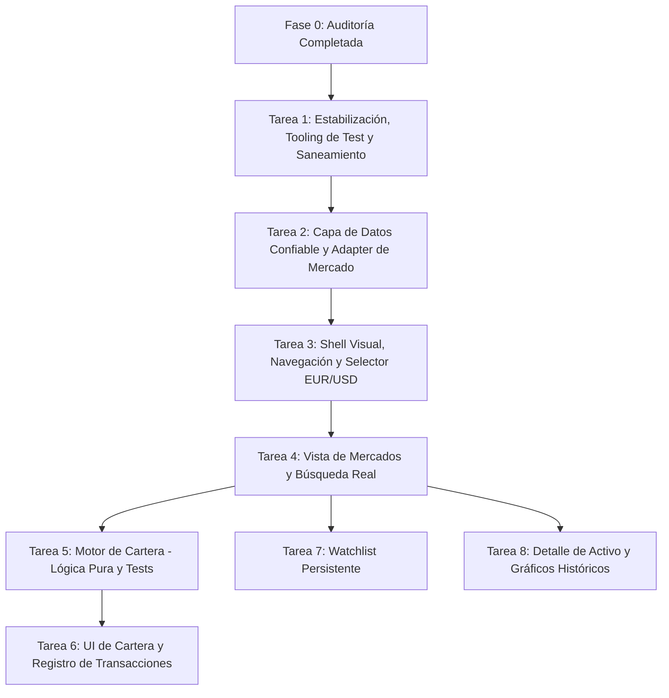

# My Crypto 2.0 — Informe de Auditoría Técnica Inicial

**Fecha:** 17 de octubre de 2026  
**Autor:** Antigravity (Pair Programming AI)  
**Estado:** Auditoría completada — Pendiente de aprobación para Fase 1 / Fase 2  

---

## 1. Resumen Ejecutivo

El proyecto `mi-crypto` se encuentra en una etapa embrionaria (un prototipo mínimo viable tipo "hello world" de consumo de API). Aunque el `README.md` lo describe como un "dashboard en tiempo real con React 18", la realidad del código es diferente:

1. **Código real vs. Documentación:** El repositorio consta únicamente de **6 archivos de código fuente** en `src/` (~160 líneas en total). No existen gráficos, ni watchlist, ni seguimiento de cartera, ni métricas globales de mercado, ni navegación, ni búsqueda por nombre de criptomoneda.
2. **Stack moderno pero con divergencias:** El proyecto utiliza **React 19.2.4**, **Vite 8.0.1** con **React Compiler 1.0.0** (vía `@rolldown/plugin-babel`), **Tailwind CSS 3.4.19** y **TypeScript 5.9.3**. El README indicaba incorrectamente React 18.
3. **Flaws críticos identificados:**
   - Hay un **error de lógica invertida en el manejo de errores** en `src/services/api.ts`: el rate limit (429) se muestra como "Error de conexión inesperado", mientras que los errores de red reales (`TypeError`) se notifican falsamente como "Límite de peticiones alcanzado".
   - **CoinGecko API** se invoca directamente desde el cliente sin API key, sin caché, sin deduplicación y sin debounce. Dado que la IP pública de clientes y navegadores está sujeta a límites estrictos (10–30 req/min), la app es altamente vulnerable a bloqueos 429 continuos.
   - **Inexistencia de suite de pruebas:** No hay ningún framework de testing instalado (`vitest` ni `jest`) ni scripts de test en `package.json`, lo que incumple directamente las directrices de `AGENTS.md` para el cálculo financiero de cartera.
   - **UX precaria:** Validación mediante `alert()` nativo, formateo monetario manual (`.toLocaleString() + '€'`) que falla con activos de precio bajo (micro-centavos), y un input numérico que solo define cuántas monedas traer, no cuáles buscar.
   - **Higiene de repositorio:** Enlaces rotos para producción en `index.html` (`/public/favicon.ico`), archivos residuales de Windows/Zone.Identifier en `public/`, y ausencia de `.env.example`.

---

## 2. Stack Tecnológico y Dependencias Verificadas

### 2.1 Dependencias reales (`package.json` y `pnpm-lock.yaml`)
| Paquete | Versión declarada | Versión bloqueada | Rol | Estado |
|---|---|---|---|---|
| `react` | `^19.2.4` | `19.2.4` | Core UI | Actualizado (React 19) |
| `react-dom` | `^19.2.4` | `19.2.4` | DOM Renderer | Actualizado |
| `vite` | `^8.0.1` | `8.0.1` | Build tool / Bundler | Versión moderna |
| `typescript` | `~5.9.3` | `5.9.3` | Tipado estático | Modo estricto configurado |
| `tailwindcss` | `3` | `3.4.19` | Framework CSS utilitario | Funcional con PostCSS |
| `postcss` | `^8.5.8` | `8.5.8` | Procesador CSS | Funcional |
| `autoprefixer` | `^10.4.27` | `10.4.27` | Prefijos CSS | Funcional |
| `babel-plugin-react-compiler` | `^1.0.0` | `1.0.0` | React Compiler | Integrado con plugin |
| `@rolldown/plugin-babel` | `^0.2.1` | `0.2.2` | Plugin Babel para Vite | Funcional |
| `@vitejs/plugin-react` | `^6.0.1` | `6.0.1` | Integración React en Vite | Funcional |
| `eslint` | `^9.39.4` | `9.39.4` | Linter | Configuración plana (Flat config) |
| `typescript-eslint` | `^8.57.0` | `8.57.1` | Reglas TS para ESLint | Funcional |

### 2.2 Scripts disponibles
- `dev`: `vite` (servidor de desarrollo local)
- `build`: `tsc -b && vite build` (comprobación de tipos y empaquetado)
- `lint`: `eslint .` (análisis estático)
- `preview`: `vite preview` (servidor de previsualización de producción)
- **Falta crítico:** `test` (no existe script de pruebas unitarias).

---

## 3. Comparativa: Funcionalidades Reales vs. Documentadas

| Módulo / Funcionalidad | Declarado en README / Docs | Implementado en Código Real | Detalle técnico real |
|---|---|---|---|
| **Mercado en tiempo real** | Sí (CoinGecko v3) | Parcial / Estático | Solo petición `fetch` manual al pulsar el botón "Ver Criptos". No hay polling ni WebSockets. |
| **Búsqueda de criptomonedas** | "Búsqueda personalizada" | ❌ No existe | Solo un `<input type="number">` que define el parámetro `per_page` (ej: 10). No se puede buscar por nombre o símbolo (BTC, ETH). |
| **Gráficos históricos** | Planeado en MVP | ❌ No existe | No hay librería de gráficos ni llamadas a `/coins/{id}/market_chart`. |
| **Detalle de activo** | Planeado en MVP | ❌ No existe | La tarjeta `CoinCard` no es interactiva ni tiene enlace a detalle. |
| **Watchlist / Favoritos** | Planeado en MVP | ❌ No existe | No hay estado persistido en `localStorage` ni botones para marcar favoritos. |
| **Cartera / Portfolio** | Planeado en MVP | ❌ No existe | No hay modelos de transacciones, costes medios, P&L ni asignación. |
| **Selector de Divisa (EUR/USD)** | Planeado en MVP | ❌ No existe | Moneda hardcodeada a `eur` en la URL de CoinGecko y símbolo `€` en `CoinCard`. |
| **Timestamp / Atribución** | Requisito AGENTS.md | ❌ No visible | La API devuelve `last_updated`, pero no se muestra al usuario ni se cita a CoinGecko. |
| **Diseño Responsive** | Reclamado en README | Parcial básico | Grid simple de Tailwind (`grid-cols-1 md:grid-cols-2 lg:grid-cols-3 xl:grid-cols-4`). El contenedor de error tiene ancho fijo `w-6/12` que se rompe en pantallas pequeñas. |

---

## 4. Mapa de Arquitectura Actual y Flujo de Datos

### 4.1 Estructura física actual
```text
mi-crypto/
├── docs/
│   ├── DECISIONS.md
│   ├── IMPLEMENTATION_PLAN.md
│   ├── PRODUCT_SPEC.md
│   └── TECH_AUDIT.md          <-- [Este informe]
├── public/
│   ├── favicon.ico
│   ├── Nueva pestaña.html:Zone.Identifier  [Archivo residual a limpiar]
│   └── Nueva pestaña_files/                [Carpeta residual a limpiar]
├── src/
│   ├── components/
│   │   └── CoinCard.tsx       [Presentación: tarjeta de moneda con estilos y formato rígido]
│   ├── services/
│   │   └── api.ts             [Llamada directa a CoinGecko sin adapter ni caché]
│   ├── types/
│   │   └── crypto.d.ts        [Tipo Cryptocurrency acoplado al JSON crudo de CoinGecko]
│   ├── App.tsx                [Monolito de estado UI, formulario y renderizado]
│   ├── index.css              [Directivas de Tailwind CSS]
│   └── main.tsx               [Montaje ReactDOM en StrictMode]
├── index.html
├── package.json
└── vite.config.ts
```

### 4.2 Flujo de datos actual
```
[ Usuario ]
     │  (Introduce número ej. 10 y pulsa botón)
     ▼
[ App.tsx ]
     │  valida con parseInt() -> si falla: alert() nativo
     ▼
[ getTopCoins({ numCryptos }) ]  en src/services/api.ts
     │
     │  fetch directo a https://api.coingecko.com/api/v3/coins/markets?vs_currency=eur...
     ▼
[ CoinGecko API Pública ]
     │
     ├── 200 OK ──────► App.tsx (setCoins) ──► renderiza lista de <CoinCard />
     ├── 429 Limit ───► throw "LIMITE_EXCEDIDO" ──► catch falla instanceof TypeError ──► "Error de conexión inesperado."
     └── Network Fail ► TypeError de fetch ─────► catch afirma falsamente: "Límite de peticiones alcanzado."
```

---

## 5. Análisis Crítico y Clasificación de Problemas

### 5.1 Problemas Bloqueantes (Prioridad Alta)

1. **Inversión lógica en el control de excepciones de `api.ts`:**
   ```typescript
   // src/services/api.ts líneas 15-28
   if (response.status === 429) throw new Error("LIMITE_EXCEDIDO");
   ...
   } catch (error: any) {
     if (error instanceof TypeError) {
       throw new Error("Límite de peticiones alcanzado. Espera un minuto antes de reintentar.");
     }
     throw new Error("Error de conexión inesperado.");
   }
   ```
   *Impacto:* Si CoinGecko responde 429 (rate limit), `new Error("LIMITE_EXCEDIDO")` **no** es un `TypeError`. Pasa al fallback "Error de conexión inesperado". En cambio, si el usuario pierde conexión a internet o hay fallo CORS, `fetch` lanza `TypeError`, informando erróneamente al usuario de que ha superado el límite de peticiones.

2. **Ausencia de entorno y pruebas unitarias (`test` runner):**
   *Impacto:* Las reglas de `AGENTS.md` exigen que toda la lógica de cálculo de cartera (P&L, coste medio, decimales, comisiones) sea pura y esté respaldada por tests unitarios automatizados. Actualmente no hay Vitest instalado ni tests configurados.

3. **Vulnerabilidad a Rate Limits de CoinGecko:**
   *Impacto:* CoinGecko público restringe severamente las llamadas anónimas. Sin caché en memoria (TTL), sin deduplicación de peticiones y sin soporte para API Key de demostración (`x-cg-demo-api-key`), la aplicación se bloqueará constantemente en cuanto el usuario navegue o interactúe.

### 5.2 Problemas Importantes (Prioridad Media)

4. **Formateo financiero deficiente:**
   - En `CoinCard.tsx`, el precio se formatea como `coin.current_price.toLocaleString() + '€'`. Si una moneda vale `0.000045 €`, `toLocaleString()` sin parámetros de precisión mínima puede truncar o mostrar `0 €`.
   - La divisa está cableada en euros; no hay soporte para USD.
   - Si `price_change_percentage_24h` viene `null` (común en monedas recién listadas en CoinGecko), `Math.abs(null).toFixed(2)` o `Math.abs(undefined)` evalúa a `0.00` o `NaN%`.
5. **Experiencia de usuario y accesibilidad:**
   - Uso de `alert()` intrusivo en el formulario de `App.tsx`.
   - La etiqueta de error tiene un ancho arbitrario `w-6/12` no responsive.
   - En `CoinCard.tsx`, los indicadores `▲` y `▼` no tienen atributos accesibles (`aria-label` o texto para lectores de pantalla).
   - No hay skeleton de carga durante la espera de la API; solo un spinner genérico centrado.
6. **Fallo en ruta de favicon para producción:**
   - En `index.html`, línea 6: `<link rel="shortcut icon" href="/public/favicon.ico" ... />`. En Vite, la carpeta `public` se sirve en la raíz `/`, por lo que `/public/favicon.ico` causará un error 404 en el build de producción.
7. **Suciedad de archivos en `public/`:**
   - Existen archivos `public/Nueva pestaña.html:Zone.Identifier` y la carpeta `public/Nueva pestaña_files/` que deben ser eliminados del repositorio.
8. **Inconsistencias en TypeScript y ESLint:**
   - Uso de `error: any` en `api.ts`, violando el principio de TypeScript estricto de `AGENTS.md`.
   - Ausencia de validación en tiempo de ejecución (schema validation o type guards) para la respuesta de la API externa.

### 5.3 Mejoras Futuras y Deuda Técnica (Prioridad Baja)

9. **Acoplamiento de tipos:** El tipo `Cryptocurrency` es un reflejo 1:1 de los campos en snake_case de CoinGecko. Debe crearse un tipo de dominio desacoplado (`Asset`) para que cambiar o añadir otro proveedor (ej. Binance, CoinCap) no obligue a reescribir los componentes visuales.
10. **Metadatos y SEO:** `index.html` tiene `<html lang="en">` y un título genérico `<title>Crypto</title>`.

---

## 6. Arquitectura Propuesta para My Crypto 2.0

Para cumplir con la directriz de **no migrar de stack, no añadir backend innecesario y aprovechar lo que funciona**, la arquitectura se estructura en 4 capas desacopladas dentro del frontend SPA:

```
┌─────────────────────────────────────────────────────────────┐
│                      CAPA DE PRESENTACIÓN                   │
│   Layout Shell (TopBar / Nav / CurrencySelector EUR-USD)    │
│   Vistas: [Mercados]  [Detalle Activo]  [Watchlist]  [Cartera]
│   Componentes UI reutilizables (MetricCard, Table, Chart)   │
└──────────────────────────────┬──────────────────────────────┘
                               │
┌──────────────────────────────▼──────────────────────────────┐
│                    CAPA DE ESTADO Y DOMINIO                 │
│   Custom Hooks / Contextos:                                 │
│   - useMarketData (gestión de consultas, polling y refresh) │
│   - useWatchlist (gestión de favoritos)                     │
│   - usePortfolio (transacciones y balances)                 │
│   Domain Logic (Funciones PURAS con tests unitarios):       │
│   - portfolioCalculations.ts (Coste medio, P&L, asignación) │
│   - formatters.ts (Monedas, %, fechas, unidades con Intl)   │
└──────────────────────────────┬──────────────────────────────┘
                               │
┌──────────────────────────────▼──────────────────────────────┐
│                  CAPA DE ALMACENAMIENTO LOCAL               │
│   storage/storageAdapter.ts                                 │
│   - Abstracción sobre localStorage                          │
│   - Validación de esquema, control de versiones y fallback   │
│     en memoria si localStorage está deshabilitado / privado │
└──────────────────────────────┬──────────────────────────────┘
                               │
┌──────────────────────────────▼──────────────────────────────┐
│                   CAPA DE SERVICIOS / ADAPTER               │
│   services/market/marketAdapter.ts (Contrato agnóstico)     │
│   services/market/coingeckoProvider.ts                      │
│   - Manejo de API Key opcional (VITE_COINGECKO_API_KEY)     │
│   - MemCache con TTL (evita 429s en recargas y cambios)    │
│   - Manejo tipado de errores (RateLimitError, NetworkError) │
│   - Normalización de datos externos -> Tipos de Dominio     │
└─────────────────────────────────────────────────────────────┘
```

### Decisiones técnicas que necesitan validación:
1. **Librería de testing:** Se recomienda instalar `vitest` y `@testing-library/react` como dependencias de desarrollo para cumplir con la verificación obligatoria de cálculos financieros.
2. **Librería de gráficos:** Para la Fase 5, se sugiere evaluar una librería ligera y robusta como `recharts` o `lightweight-charts` (TradingView), o un canvas nativo SVG para línea de tendencia, evitando dependencias pesadas innecesarias.
3. **Manejo de API Key:** Permitir configurar opcionalmente una clave demo gratuita de CoinGecko mediante variable de entorno `VITE_COINGECKO_API_KEY` en el cliente, respetando que para el MVP no se requiere backend.

---

## 7. Plan de Implementación Ordenado y Desglosado

Siguiendo el marco de `docs/IMPLEMENTATION_PLAN.md`, se estructuran las tareas con sus dependencias y criterios de aceptación:



---

## 8. Primera Tarea Recomendada

### **Tarea 1: Estabilización Técnica, Saneamiento y Tooling de Pruebas**

* **Objetivo:** Dejar el proyecto en un estado higiénico, robusto y verificable, configurando el entorno de tests unitarios necesario para las fases posteriores y corrigiendo los fallos evidentes de tipado, error handling y ficheros estáticos.
* **Archivos a modificar / crear:**
  - `package.json`: Añadir script `test` e instalar dependencias de desarrollo estrictamente necesarias (`vitest`).
  - `src/services/api.ts`: Corregir el bug de detección de 429 y `TypeError`, eliminando `any`.
  - `index.html`: Corregir ruta del favicon a `/favicon.ico`, idioma a `es` y título descriptivo.
  - `public/`: Eliminar archivos residuales de Windows (`Nueva pestaña...`).
  - `.env.example`: Crear plantilla de variables de entorno documentada.
* **Criterios de Aceptación:**
  1. `pnpm run lint` pasa sin advertencias ni errores.
  2. `pnpm run build` genera el bundle de producción sin fallos.
  3. `pnpm run test` ejecuta la suite de tests (con un test de prueba inicial) satisfactoriamente.
  4. Los errores de red y de límite de API se tipan y diferencian correctamente sin invertir su significado.
  5. Los archivos residuales de `public/` desaparecen y el favicon carga sin 404.
